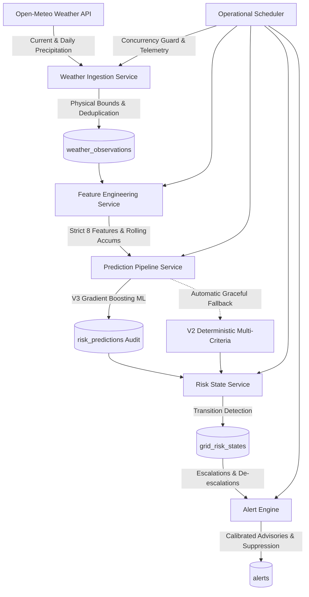
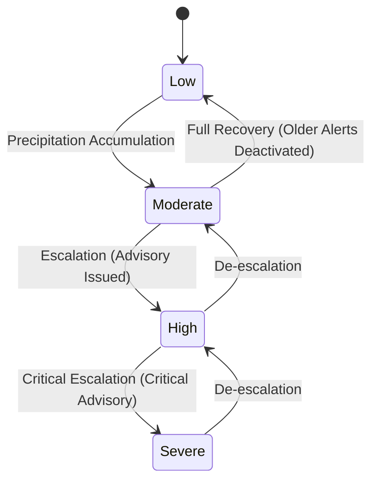

# GeoGuard V4 — Near-Real-Time Operational Flood Intelligence

## 1. Overview
GeoGuard V4 transforms the platform from an on-demand API into a continuously operating flood intelligence platform for Chennai. It actively:
1. Ingests live weather data from Open-Meteo with physical boundary validation and retry backoff.
2. Generates feature sets matching the V3 Gradient Boosting model specification.
3. Performs automated batch inference across all 34 monitored sectors.
4. Tracks spatial risk transitions and maintains persistent state history in PostgreSQL/PostGIS.
5. Issues non-authoritative advisory bulletins with deduplication and automated de-escalation recovery.
6. Safeguards execution using a non-blocking concurrency guard (`threading.Lock`).

---

## 2. Pipeline Architecture



---

## 3. Risk State Machine & Transition Logic

Each monitored sector maintains state within `grid_risk_states`:
- **Initial State**: First recorded prediction (`None -> Level`).
- **Unchanged**: Current prediction matches active state (`Level == Level`). No alert is dispatched.
- **Escalation**: Risk increases (`Low -> Moderate`, `Moderate -> High`, `High -> Severe`). Generates calibrated advisory bulletins.
- **De-escalation**: Risk subsides (`Severe -> Moderate`, `High -> Low`). Issues recovery notification and deactivates prior active warnings.



---

## 4. Alert Engine & Advisory Calibration

GeoGuard is a **decision-support platform**, not an authority issuing mandatory evacuation orders. All alerts use calibrated, advisory language:
- **Critical (`High -> Severe`)**: *"Severe flood hazard potential detected. Residents in low-lying areas should consider moving toward the nearest available safe shelter."*
- **Warning (`Moderate -> High`)**: *"High flood risk detected. Prepare emergency supplies and review nearby shelter locations."*
- **Informational (`Low -> Moderate`)**: *"Moderate flood risk detected due to increased precipitation."*
- **Informational (De-escalation)**: *"Flood risk has reduced from [Level] to [Level]. Continue monitoring weather advisories."*

### Deduplication Strategy:
- Alerts are deduplicated by sector ID, current severity, and active state.
- Duplicate transitions within the same risk level will not generate duplicate active alerts.
- Operators can acknowledge alerts via `POST /api/alerts/{id}/acknowledge`.

---

## 5. Concurrency Guard & Operational Scheduling

The `OperationalScheduler` coordinates automated intelligence cycles:
- **Interval**: Configurable via `PREDICTION_INTERVAL_SECONDS` (default: 60s) and `WEATHER_SYNC_INTERVAL_SECONDS` (default: 300s).
- **Concurrency Guard**: Employs a non-blocking `threading.Lock`. If an existing cycle is active, overlapping invocations are skipped and logged as `prediction_cycle_skipped`.
- **Fault Recovery**: Exceptions during ingestion, inference, or persistence are caught, logged as `prediction_cycle_failed`, and do not crash the scheduler thread.

---

## 6. Real-Time Telemetry & Health Monitoring

### `GET /api/operations/status`
Returns real operational status:
```json
{
  "weather_status": "healthy",
  "last_weather_sync": "2026-09-03T14:15:00",
  "last_prediction_run": "2026-09-03T14:25:09",
  "next_prediction_run": "2026-09-03T14:26:09",
  "model_version": "v3.0.0",
  "active_model": "Gradient Boosting",
  "fallback_active": false,
  "active_alerts": 25,
  "high_risk_grids": 0,
  "prediction_latency_ms": 70.11,
  "scheduler_status": "running"
}
```

### `GET /api/health`
Granular component-level health breakdown:
```json
{
  "status": "healthy",
  "version": "2.0.0",
  "database": "connected (PostGIS 3.6)",
  "components": {
    "application": "healthy",
    "database": "healthy",
    "weather": "healthy",
    "ml_model": "healthy",
    "scheduler": "running"
  }
}
```

---

## 7. Empirical Pipeline Performance Baseline

Measured using `scripts/benchmark_prediction_pipeline.py` (20 sample iterations across all 34 monitored sectors):

| Operational Component | Average Latency | Median (p50) | 95th Percentile (p95) |
| :--- | :--- | :--- | :--- |
| **Feature Generation (34 sectors)** | 16.77 ms | 17.66 ms | 20.05 ms |
| **ML Inference (34 sectors)** | 46.47 ms | 45.60 ms | 50.94 ms |
| **Database Persistence (34 records)** | 4.27 ms | 3.97 ms | 5.46 ms |
| **Complete Operational Cycle** | **70.11 ms** | **67.30 ms** | **86.83 ms** |
